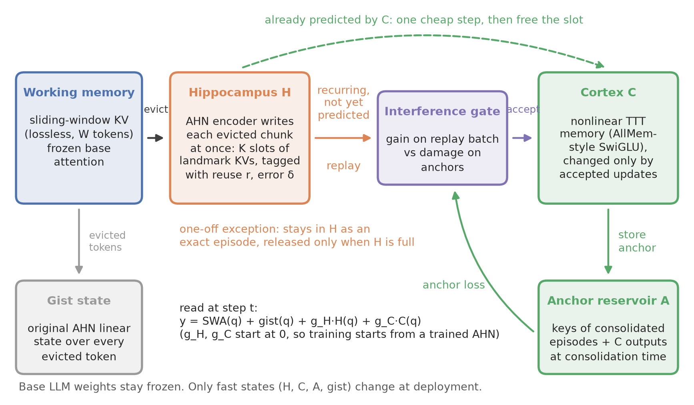
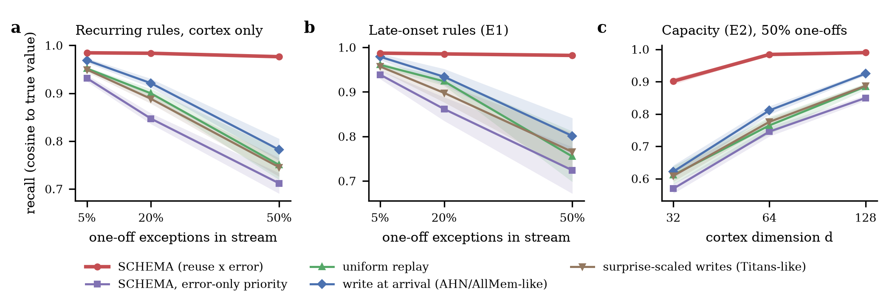
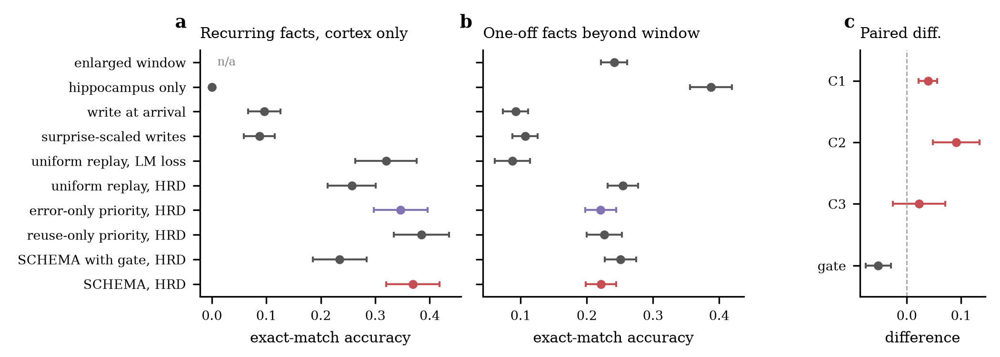

# SCHEMA: complete research record

*Selective Consolidation of Hippocampal Episodes into Memory under Anti-interference control*

Project record written 17 Nov 2026, covering the work from 12 Oct to 17 Nov 2026. It is meant as the source document for writing the paper. Every number below is copied from a saved analysis file (listed in Section 15). Contrasts are paired over streams with 95% bootstrap confidence intervals (10,000 resamples, seed 0) unless stated otherwise. "W/T/L" means wins, ties and losses over paired streams.

---

## 0. Summary

**Question.** Can a neural network continually acquire new experiences, selectively consolidate useful knowledge, and preserve previously learned information without repeatedly retraining its foundational parameters?

**Starting point.** Hybrid long-context models (AHN, AllMem) keep an exact sliding window and compress every evicted token into a fixed-size memory, once, in arrival order, with no check on what the write does to older content. Titans scales writes by surprise. In Complementary Learning Systems (CLS) terms these designs merge the hippocampus and the neocortex into one store.

**Proposal.** SCHEMA splits memory into three stores on top of a frozen base model: an exact sliding window (working memory), a hippocampus H that stores episodes at once without gradient steps, and a slow cortex C that changes only through replay. Replay priority combines reuse (how often an episode was needed again) with cortical error (how badly C alone still handles it). One-off surprising events stay in H; recurring items are consolidated. An optional interference gate accepts a replay step only if its gain on new episodes outweighs its damage on anchors of old knowledge.

**What we found.**
1. In a controlled associative-memory study (linear cortex, 135 paired streams), recurrence-weighted routing keeps cortex recall near ceiling (0.98) at every exception rate, while error-only (surprise-like) priority, arrival-time writes and surprise-scaled writes degrade as one-off events become common: +0.151 [+0.134, +0.170] over error-only priority, positive on 135/135 streams. The gap grows with exception rate and shrinks with cortex capacity, so the cost of surprise-driven consolidation is crowding, not targeted interference.
2. On frozen Qwen2.5 LLMs, the decisive ingredient turned out to be the write rule. Our new rule, **hippocampal recall distillation (HRD)**, trains the cortex only on episodes that the model was seen to recall from H, using context distillation from the frozen model that has the episode in context. HRD consolidates recurring facts without damaging the model (held-out NLL 2.42 vs 4.08 for next-token LoRA replay), never consolidates one-off facts, and beats the released AHN-GDN-3B by +0.312 [+0.282, +0.343] on our primary score (40/0/0).
3. A pre-registered confirmatory test on fresh streams (Qwen2.5-1.5B, 40 streams) passed C1 (SCHEMA priority beats uniform replay with the same write rule, +0.039 [+0.022, +0.056]) and C2 (beats next-token LoRA replay, +0.091 [+0.048, +0.134]) and failed C3 (reuse-weighted priority beats error-only priority on cortex recall, +0.022 [-0.025, +0.071]).
4. The C1 gain did **not** replicate on Qwen2.5-3B (-0.010 [-0.032, +0.014]). At 16k tokens on 1.5B it held only for recurring-fact recall (+0.079 [+0.038, +0.122]), with a matching loss on one-off facts (-0.041).
5. The interference gate, one of the three design principles, consistently hurt: -0.052 [-0.075, -0.030] on the LLM (30 of 40 streams lost), no recall effect in simulation, about four times the compute.

**Honest one-line claim.** Consolidating only what the episodic store has been seen to recall, by distilling the model's own in-context behaviour into slow weights, is a robust way to add continual memory to a frozen LLM; recurrence-weighted *selection* among those episodes is a capacity-dependent trade-off (clear in a small cortex, absent at 3B), and gating steps against interference is not worth its cost.

---

## 1. Research question and hypotheses

### 1.1 Central question
Can a model keep learning at deployment from a stream of experiences, choose what is worth turning into durable knowledge, and keep what it already knew, while its foundation weights stay frozen?

### 1.2 CLS design principles taken as hypotheses
From McClelland, McNaughton and O'Reilly (1995) and Kumaran, Hassabis and McClelland (2016):
1. **Fast acquisition, slow integration.** A fast episodic store encodes each experience at once; a slow distributed store changes only gradually through replay.
2. **Selective replay.** What recurs and is predictive should be consolidated; exceptions should remain as episodes.
3. **Protection against interference.** New learning should be interleaved with old material and should not overwrite old structure.

### 1.3 Main hypothesis (H0, from the proposal)
A test-time memory continually acquires and preserves knowledge better when it (i) writes every experience into an episodic store at once, (ii) consolidates into slow weights only what recurs and is not yet predicted, and (iii) accepts each consolidation step only if its measured gain on recent episodes exceeds its measured damage on anchors of old knowledge.

### 1.4 The "surprise paradox" sub-claim
Titans uses surprise as a reason to write into its memory. CLS suggests surprise is a reason to store an *episode*, and that consolidation should depend on recurrence. For a delta-rule memory with unit-norm keys, writing a one-off exception (k_e, v_e) with error e_e = v_e - W k_e and step eta_e changes recall of a stored regularity (k_r, v_r) by

    W' k_r - W k_r = eta_e (k_e . k_r) e_e,   ||Delta|| = eta_e |c| ||e_e||,  with c = k_e . k_r

Since the delta rule already writes in proportion to error, any surprise gate that increases eta_e with ||e_e|| makes damage to correlated regularities grow faster than linearly in surprise. Under SCHEMA a one-off exception is not written into the cortex until it recurs, so its first-order damage to the cortex is zero, and it stays retrievable in H.

### 1.5 Falsifiable predictions (fixed in the proposal, 12 Oct)

| ID | Prediction | Kill criterion |
|---|---|---|
| P1 | Recurrence routing beats surprise routing on rule retention; the gap grows with exception rate and key correlation | No crossover across 3 seeds at matched budget: drop the surprise-paradox claim |
| P2 | Exceptions remain recallable from H at delays where AHN/AllMem-style memories have lost them | Exception recall not above an enlarged-window SWA at equal bytes |
| P3 | The interference gate lowers anchor loss and forgetting without lowering acquisition | Removing the gate changes neither: the gate is decorative |
| P4 | After clearing window and H, recurring facts are still answerable from C alone (test-retest) | No retained recall from C alone: reframe as an episodic-memory paper |
| P5 | No regression on standard long-context benchmarks relative to AHN | (not tested in this project) |

---

## 2. Existing work and the gap

### 2.1 The two source architectures

| Property | AHN (Fang et al., ICML 2026, arXiv 2510.07318) | AllMem (Wang et al., arXiv 2602.13680) | What CLS asks for |
|---|---|---|---|
| Short-term store | Sliding-window KV, lossless | Sliding-window attention with sinks, lossless | Same: limited, exact working memory |
| Long-term store | One linear recurrent state per head (Mamba2, DeltaNet, GatedDeltaNet) | One nonlinear SwiGLU fast-weight memory per head, chunk-wise TTT with momentum | Two stores: fast sparse episodic, slow distributed |
| When written | When a token leaves the window | Every chunk in the forward pass | Episodic at once; slow store later, by replay |
| What is written | Everything (learned gates set strength) | Everything (learned token-wise learning rate) | Everything to episodic; a selected subset to slow |
| How many times | Once | Once | Many times, interleaved |
| Interference control | Decay gate | Weight normalization between read and update; frozen base | Explicit protection of old structure |
| Training | KL self-distillation, base frozen | KL self-distillation, base frozen | (not a CLS property) |

AllMem's own conclusion points to a multi-level memory hierarchy as future work. SCHEMA is one concrete answer.

### 2.2 Related lines of work

| Work | Contribution | What it leaves open |
|---|---|---|
| Titans (arXiv 2501.00663) | Neural memory written at test time, write strength from surprise | Surprise drives consolidation; single store, no episodic route |
| MIRAS (Behrouz et al. 2025) | Unifies memories via architecture, attentional bias, retention gate, inner optimizer | Retention is regularization inside one store; nothing chooses what deserves the slow store |
| Nested Learning / Hope (arXiv 2512.24695) | Continuum memory, modules at different update frequencies | Every token flows through every level; no episodic buffer, no replay |
| Lee et al., "Do Language Models Need Sleep?" (arXiv 2605.26099) | Offline recurrence turns recent context into SSM fast weights | Consolidates everything, no selection, no episodes kept |
| Behrouz et al., "Language Models Need Sleep" (arXiv 2606.03979) | Sleep with knowledge seeding and RL dreaming | Expensive (RL, synthetic data), not a per-chunk inference-time mechanism |
| Palimpsa (arXiv 2602.09075) | Bayesian metaplasticity per memory state | Single fixed-size store; complementary (could be SCHEMA's cortex optimizer) |
| EVAF (arXiv 2606.29916) | Surprise/valence gated LoRA consolidation with replay and test-retest probes | Uses surprise as a positive gate; agent behaviour, not architectural memory |
| SleepGate (arXiv 2603.14517) | Sleep-inspired forgetting gate over the KV cache | No slow cortex, no interference test |
| TRC^2 (arXiv 2602.22479) | Hippocampal replay stores for continual LM training | Training-time replay with next-token loss |
| ComMem (CoLLAs 2026) | Fast cache plus slow abstract memory for VLM test-time adaptation | Classification prototypes, not sequence fast weights |
| Fast-weight PKM (arXiv 2601.00671) | Fast-weight episodic memory beside GDN and SWA | No consolidation route |
| TTT-KV binding (arXiv 2602.21204) | TTT layers act as learned linear attention | Motivates test-retest probes with window and H cleared |
| How Linear Attention Remembers (arXiv 2609.33093) | Interference from later writes depends on overlap with stored keys | Supports the overlap-based interference model (Proposition 1) |

### 2.3 Knowledge-injection literature that shaped the final write rule
* Allen-Zhu & Li, Physics of LMs 3.1 (ICML 2024): facts trained in one surface form can be memorized but not extracted by questions.
* Snell et al. 2022, Learning by Distilling Context; Padmanabhan et al., NeurIPS 2023: a teacher that sees the fact in context, distilled into the student, injects knowledge better than fine-tuning.
* Caccia et al., COLM 2025 (Knowledge Modules, deep context distillation): next-token prediction performs poorly as the knowledge objective.
* Lin et al. 2025 (Sparse Memory Finetuning, arXiv 2510.15103); Biderman et al., TMLR 2024 (LoRA learns less and forgets less).

### 2.4 The gap
No prior method combines (a) a separately addressable episodic store that keeps exceptions exact, (b) per-episode consolidation decisions driven by reuse and by what the slow store already predicts, and (c) an explicit measured trade-off between gain on new material and damage to old, inside an inference-time memory with a frozen base. After the LLM experiments, the sharper gap is: none of the consolidation methods selects what to consolidate from *where the episodic memory was actually needed*, and none uses the model's own hippocampus-assisted behaviour as the consolidation target.

---

## 3. The proposed method

*The figure shows the design as proposed on 12 Oct (AHN-style encoder for H, AllMem-style TTT cortex, AHN gist state). The experiments used the simplified instantiations described below: a training-free landmark selector for H, a linear cortex in the controlled study and a rank-8 LoRA cortex on the LLM, and no gist state.*

### 3.1 Stores (per layer and KV head)
* **Working memory.** Frozen base attention over a sliding window of W tokens plus sinks.
* **Hippocampus H.** Episodes written at once when tokens leave the window (no gradient step). In the LLM experiments an episode is a set of landmark key-value pairs chosen by a training-free, self-distilled landmark selector; the landmarks join the frozen attention softmax at read time (InfLLM-style).
* **Cortex C.** Read on every step, changed only during periodic "micro-sleeps". Linear fast-weight matrix in the controlled study; rank-8 LoRA (MLP and o_proj) on the LLM.
* **Anchor reservoir A.** R pairs (key, cortex output at consolidation time), kept by reservoir sampling. Used for interleaving and for the gate.

### 3.2 Tags and routing
Each episode j carries a reuse tag r_j and a cortical error delta_j.

| Case | Condition | Action |
|---|---|---|
| Already consolidated | delta_j < tau | Release the slot, add anchors |
| Recurring and not yet predicted | delta_j >= tau and r_j >= r_min | Replay with probability proportional to log(1 + r_j) * delta_j |
| One-off exception | r_j < r_min | Keep as an episode; release only under capacity pressure |

Replay batches mix sampled episodes with anchors (interleaving).

### 3.3 Interference gate (optional)
For a candidate update, gain G = loss on the replay batch before minus after; damage D = loss on anchors after minus before. Accept if G - rho*D > 0, otherwise halve the step up to twice, then defer. Before the look-ahead, an A-GEM projection removes the component of the batch gradient that conflicts with the anchor gradient. Variants tested: mean-normalized damage, sum-normalized damage (dsum) with rho 1 or 4, A-GEM only, look-ahead only.

**Proposition 1 (linear cortex).** With batch keys K_B, residual R_B, and anchors fitted so that their residual is zero, for the step W' = W - eta R_B K_B^T:

    G(eta) = eta <R_B, R_B M_BB> - (eta^2/2) ||R_B M_BB||^2
    D(eta) = (eta^2/2) ||R_B M_BA||^2,   M_BB = K_B^T K_B,  M_BA = K_B^T K_A
    eta*   = <R_B, R_B M_BB> / ( ||R_B M_BB||^2 + rho ||R_B M_BA||^2 )

The interference-aware step shrinks exactly with key overlap between new episodes and anchors. These expressions were checked numerically, and the torch implementation reproduces them in a unit test.

### 3.4 Hippocampal recall distillation (HRD): the write rule for an LLM cortex
Developed on 4 Nov after next-token LoRA consolidation failed (Section 9).
* **Reuse signal (label-free).** A "confirmed copy": the model reads an H landmark and the stream then produces that landmark's token. Each confirmed copy turns the surrounding passage into a *recall query* for that episode; r_j counts confirmed recalls.
* **Target.** At each recall query, the cortex is trained so that the model *without* H matches the frozen model that sees the episode in context (KL; context distillation in the sense of Snell et al. and Padmanabhan et al.).
* **Cortical error.** delta_j = remaining KL at the episode's recall queries.
* **Consequence.** Episodes that are never recalled get no query, so they are never consolidated. One-off facts stay in H by construction.

### 3.5 Budget rules used in every comparison
* **Equal memory bytes.** Every LLM arm holds W plus 2,048 key-value pairs per layer and KV head. The LoRA cortex is charged against this budget (540 pairs on 1.5B, 676 on 3B), and so are anchors and auxiliary keys. A unit test (tests/test_pilot_budget.py) enforces this.
* **Equal replay compute.** Every replay arm sleeps every 4 chunks and takes 8 steps per sleep. Arrival and surprise arms take 2 steps per chunk.
* **Enlarged-window control.** swa_big gives all the extra bytes to a larger exact window.

---

## 4. Experimental programme and timeline

| Date | Stage | Purpose | Outcome |
|---|---|---|---|
| 12 Oct | Proposal | Method, predictions, kill criteria | schema_proposal.md |
| 3 Nov | Stage 0a M1 grid | Controlled test of routing, gate, budget (linear cortex), 1,755 runs | Conditional pass: P1 strong, P2 partial, P3 unattributed |
| 3 to 4 Nov | Stage 0b | Train a tiny SWA+gist LM from scratch to host SCHEMA | Failed backbone gates repeatedly; dropped |
| 4 Nov | Frozen LLM pilot (training-free) | H and a slot cortex on Qwen2.5-1.5B | P2 and P4 pass; P1 fails (no reuse signal) |
| 4 Nov | Linear cortex on LLM | Proposition-1 cortex with trained read gates | Blocked by the read path |
| 4 Nov | Retrofit R0, R2 | Released AHN-GDN-3B as the memory | AHN recalls no exact fact; fine-tuning fails the recall bar |
| 4 Nov | LoRA cortex, next-token loss | Weight-space cortex | SCHEMA loses to uniform replay (-0.143) |
| 5 Nov | HRD test (pre-registered) | New write rule | hrd_schema fails its bar; post-hoc no-gate variant wins |
| 16 Nov | Stage 0a P2b, E1, E2 | Fix grid edges, isolate the gate, late-onset rules, capacity | 2,565 + 210 + 420 runs, 0 errors |
| 16 Nov | Confirmatory test (pre-registered) | No-gate SCHEMA with HRD on fresh seeds | C1, C2 pass; C3 fails |
| 16 to 17 Nov | Gate arm, 3B replication, 16k streams | Generality | Gate hurts; C1 does not replicate at 3B; 16k shows a rule/exception trade |

Compute: Stage 0a on CPU (about 1 to 3 s per run); LLM work on an RTX 4090 (4 to 5 Nov) and on 2 A6000 GPUs (16 to 17 Nov).

---

## 5. Stage 0a: controlled associative-memory study

### 5.1 Setup
* **Stream ("Rules and Exceptions").** T = 2,400 chunks of 4 key-value pairs, d = 64. 32 rules recur with Zipf frequencies (skew 0.5, 1.0, 1.5). One-off exceptions appear at rate 5, 20 or 50%, with keys at cosine 0, 0.3 or 0.6 to a rule key. 25% of rules change value mid-stream (drift).
* **Grid.** 27 cells (exception rate x key correlation x skew) x 5 test seeds = 135 paired streams per arm.
* **Equal bytes.** Window, H and anchors share one budget.
* **Tuning.** Each arm's step size eta chosen on validation seeds 0 to 2.
* **Main metric.** `cortex_rule`: cosine recall of recurring rules from the cortex alone. (Combined window+cortex recall is near ceiling for most arms because the window keeps recent copies of frequent rules, so it does not discriminate.)
* **Other metrics.** exc_recent / exc_mid / exc_old: exception recall at increasing age (mid = 64 to 256 chunks, old = 256 to 1,024); anchor_loss; cortex_rule_drifted_old (cosine to the stale value of a drifted rule, lower is better).

### 5.2 Arms
* **schema**: H + recurrence-weighted replay + anchors + gate (FIFO eviction default since 3 Nov).
* **schema_surprise_pri**: same system, priority by error only (surprise-like).
* **arrival_fifo**: writes at arrival into C plus an exact window of equal bytes (AHN/AllMem-like).
* **surprise_fifo**: as arrival, with surprise-scaled steps (Titans-like).
* **uniform_replay**: uniform replay over the buffer (no anchors, so twice the episodic store).
* **sleep_all**: sleep over the whole buffer then clear it (Lee et al.-like).
* Ablations: schema_nogate, schema_agem_only, schema_lookahead_only, schema_dsum, schema_dsum_rho4, schema_R64, schema_R128 (smaller anchor reservoirs), schema_noreconsol, schema_nosupersede, schema_redundancy_evict.

### 5.3 First grid, M1 (3 Nov; 13 arms, 1,755 runs, 0 failures)
* P1 strongly supported: schema vs schema_surprise_pri +0.246 cortex recall, 135/135 streams (minimum +0.170); vs surprise_fifo +0.103, 135/135; arrival_fifo vs surprise_fifo +0.030, 135/135.
* The gap grew with exception rate (+0.20, +0.23, +0.30 at 5, 20, 50%) but barely with key correlation (+0.199, +0.203, +0.214 at 5% exceptions for correlation 0, 0.3, 0.6). The gap was +0.14 for the most frequent third of rules and +0.30 to +0.31 for the rarer two thirds. **Interpretation:** the damage is aggregate crosstalk in a limited-capacity cortex plus replay starvation of rare rules, not targeted interference near rule keys.
* P2 held only while exceptions were a minority (schema minus arrival_fifo on exceptions aged 64 to 256: +0.639 at 5%, +0.444 at 20%, -0.103 at 50%), because the anchor reservoir took half the episodic budget.
* P3: the mean-normalized gate never fired but schema still beat schema_nogate by +0.013; attribution was open (A-GEM or learning-rate grid edge). Several eta grids ended at an edge, so a retune (P2b) was required.
* Component decisions: FIFO eviction became the default (redundancy eviction did not clear its +0.05 bar); reconsolidation kept; superseding stale copies had no effect.

### 5.4 Retune with wide grids (P2b, 16 Nov; 19 arms, 2,565 runs, 0 errors)
Only sleep_all ended at its grid edge (eta 8.0). Arm means over 27 cells x 5 seeds (selected arms):

| arm | cortex_rule | exc_mid | exc_old | anchor_loss | n_anchors |
|---|---|---|---|---|---|
| schema | 0.981 | 0.737 | 0.315 | 0.008 | 256 |
| schema_nogate | 0.982 | 0.739 | 0.315 | 0.018 | 256 |
| schema_R64 | 0.982 | 0.915 | 0.438 | 0.012 | 64 |
| schema_R128 | 0.982 | 0.858 | 0.404 | 0.008 | 128 |
| schema_noreconsol | 0.972 | 0.734 | 0.307 | 0.065 | 256 |
| arrival_fifo | 0.891 | 0.390 | 0.044 | n/a | 0 |
| uniform_replay | 0.867 | 0.814 | 0.210 | n/a | 0 |
| surprise_fifo | 0.861 | 0.419 | 0.064 | n/a | 0 |
| schema_surprise_pri | 0.830 | 0.352 | 0.085 | 0.006 | 219.7 |
| sleep_all | 0.672 | 0.263 | 0.034 | n/a | 0 |

**P1, recurrence routing (cortex_rule):**

| comparison | diff | 95% CI | positive | exc 5% | exc 20% | exc 50% |
|---|---|---|---|---|---|---|
| schema - schema_surprise_pri | +0.151 | [+0.134, +0.170] | 135/135 | +0.053 | +0.137 | +0.265 |
| schema - surprise_fifo | +0.120 | [+0.104, +0.138] | 135/135 | +0.035 | +0.095 | +0.231 |
| schema - arrival_fifo | +0.091 | [+0.074, +0.108] | 120/135 | +0.016 | +0.063 | +0.194 |
| schema - uniform_replay | +0.114 | [+0.096, +0.133] | 135/135 | +0.033 | +0.084 | +0.226 |
| schema - sleep_all | +0.309 | [+0.244, +0.378] | 120/135 | +0.375 | +0.356 | +0.197 |
| arrival_fifo - surprise_fifo | +0.030 | [+0.028, +0.031] | 135/135 | +0.019 | +0.033 | +0.037 |

**P2, exceptions beyond the window:**

| comparison | metric | diff | 95% CI | exc 5% | exc 20% | exc 50% |
|---|---|---|---|---|---|---|
| schema - arrival_fifo | exc_mid | +0.347 | [+0.284, +0.409] | +0.639 | +0.572 | -0.169 |
| schema - uniform_replay | exc_mid | -0.077 | [-0.107, -0.047] | +0.000 | +0.070 | -0.301 |
| schema - arrival_fifo | exc_old | +0.271 | [+0.198, +0.346] | +0.884 | -0.043 | -0.028 |
| schema - uniform_replay | exc_old | +0.105 | [+0.070, +0.142] | +0.394 | -0.066 | -0.014 |

**Anchor budget.** Shrinking the reservoir returns bytes to H at no cortex cost:

| comparison | metric | diff | 95% CI |
|---|---|---|---|
| schema_R64 - schema | cortex_rule | +0.001 | [+0.000, +0.001] |
| schema_R64 - schema | exc_mid | +0.177 | [+0.139, +0.218] (exc 50%: +0.504) |
| schema_R128 - schema | exc_mid | +0.121 | [+0.096, +0.147] |
| schema_R64 - uniform_replay | exc_mid | +0.101 | [+0.082, +0.120] |

**P3, gate attribution (difference vs schema_nogate):**

| arm | cortex_rule diff | anchor_loss diff (negative = less damage) |
|---|---|---|
| schema (mean gate + A-GEM) | -0.000 [-0.001, +0.000] | -0.010 [-0.011, -0.009] |
| schema_agem_only | +0.001 [+0.000, +0.001] | -0.004 [-0.005, -0.003] |
| schema_lookahead_only | -0.008 [-0.012, -0.004] | -0.010 [-0.011, -0.009] |
| schema_dsum_rho4 | +0.001 [+0.001, +0.002] | -0.014 [-0.015, -0.013] |

The M1 "gate gain" was a learning-rate grid-edge artefact. With proper tuning, the gate lowers anchor damage slightly and does not change recall.

**Reconsolidation.** Without reconsolidating anchors when a rule changes, the stale value lingers: cortex_rule_drifted_old +0.111 [+0.100, +0.121], 132/135.

### 5.5 E1: late-onset rules (210 runs; 10 seeds x 3 exception rates)
Rules that start mid-stream, so their first occurrence looks exactly like a one-off.

| arm | late-rule cortex recall, exc 5% | exc 20% | exc 50% |
|---|---|---|---|
| schema | 0.987 | 0.985 | 0.982 |
| schema_nogate | 0.987 | 0.982 | 0.981 |
| arrival_fifo | 0.979 | 0.934 | 0.801 |
| uniform_replay | 0.961 | 0.924 | 0.755 |
| surprise_fifo | 0.957 | 0.898 | 0.765 |
| schema_surprise_pri | 0.939 | 0.862 | 0.724 |
| sleep_all | 0.125 | 0.836 | 0.804 |

| late-rule contrast | diff | 95% CI | positive |
|---|---|---|---|
| schema - schema_surprise_pri | +0.143 | [+0.110, +0.180] | 30/30 |
| schema - surprise_fifo | +0.111 | [+0.082, +0.143] | 30/30 |
| schema - arrival_fifo | +0.080 | [+0.052, +0.110] | 28/30 |
| schema - uniform_replay | +0.105 | [+0.072, +0.143] | 30/30 |
| schema - sleep_all | +0.396 | [+0.256, +0.545] | 30/30 |

A regularity that first looks like an exception is still consolidated once it recurs. This answers the obvious objection that "keep one-offs out" might block new rules.

### 5.6 E2: cortex capacity (420 runs; 10 seeds x exc 0.2, 0.5 x d in {32, 64, 128})

| d | exc | schema | surprise_pri | schema - surprise_pri | schema - uniform_replay |
|---|---|---|---|---|---|
| 32 | 0.2 | 0.917 | 0.728 | +0.189 [+0.177, +0.203] | +0.132 [+0.121, +0.146] |
| 32 | 0.5 | 0.901 | 0.569 | +0.332 [+0.321, +0.345] | +0.290 [+0.270, +0.314] |
| 64 | 0.2 | 0.986 | 0.866 | +0.120 [+0.116, +0.125] | +0.062 [+0.058, +0.066] |
| 64 | 0.5 | 0.984 | 0.746 | +0.238 [+0.226, +0.251] | +0.219 [+0.197, +0.241] |
| 128 | 0.2 | 0.991 | 0.930 | +0.062 [+0.059, +0.065] | +0.025 [+0.022, +0.029] |
| 128 | 0.5 | 0.990 | 0.850 | +0.140 [+0.134, +0.148] | +0.105 [+0.096, +0.112] |

The advantage of recurrence routing shrinks as the cortex grows. Consolidating surprising one-offs spends limited capacity and replay budget on items that never return. **This result later explains why the LLM selection effect fades at 3B.**

---

## 6. Stage 0b: training a small model from scratch (dropped)
Plan: a 4-layer, d256 chunked-SWA language model (c 64, W 128) with an AHN-style gated delta-rule gist (about 5.1M parameters), trained on token streams with private rule sets, as a host for SCHEMA with trained read paths.
* **G0 (3 Nov):** within-window probe accuracy 0.02 to 0.10 after 2,000 steps (bar: 0.95). Diagnosis: an in-context frequency shortcut.
* **S1 sanity (4 Nov):** a dense 2-layer model with single-token keys reached 0.193 probe accuracy in 1,500 steps, below the "copy the most recent value" shortcut (0.244).
* **R1:** a reference GPT also stayed at shortcut level. Root cause: the masked-only training loss (about 90 of 512 positions) prevents induction-head formation.
* **Decision:** drop Stage 0b and move to frozen pretrained models, which already retrieve from context. One sentence in the paper is enough (why we did not train a model from scratch).

---

## 7. Frozen-LLM pilot, training-free (4 Nov)

### 7.1 Setup (kept for all later LLM experiments)
* **Model:** Qwen2.5-1.5B-Instruct, frozen; 64-token chunks; W = 1,024 plus 4 sinks.
* **Stream:** 8,192 tokens of facts about invented people between wikitext-103 passages (74% filler). 16 recurring facts (Zipf 1.0, paraphrased), one-off exceptions at rate 0.2 or 0.5 that share a person with a recurring fact, and 25% of recurring values changed at the midpoint.
* **Probes:** read-only questions after the stream, exact match of the value. **Retest:** window and H cleared, so only C can answer.
* **Primary score per stream:** 0.5 x retest rule accuracy + 0.5 x exception accuracy beyond W.
* **Landmark selector:** a linear probe on the layer-14 hidden state, fitted by self-distillation to the full-attention teacher's question attention (no labels). Model surprise (NLL) selected landmarks at chance.

### 7.2 Results (test seeds 100 to 119, 40 streams)

| arm | exc beyond W | exc > 4W | retest rule (C only) | primary |
|---|---|---|---|---|
| teacher (full attention) | 0.870 | 0.835 | | |
| swa (W only) | 0.000 | 0.000 | | |
| swa_big (equal bytes) | 0.275 | 0.000 | | |
| hippo (H only) | **0.408** | **0.344** | 0.000 | 0.204 |
| schema (slot cortex) | 0.359 | 0.265 | 0.277 | 0.318 |
| surprise (Titans-like) | 0.404 | 0.346 | 0.301 | 0.353 |
| arrival (AllMem-like) | 0.397 | 0.368 | 0.239 | 0.318 |

* **P2 pass:** H 0.408 vs enlarged window 0.275 beyond W (+13.3 points, 37/40 streams); beyond 4W 0.344 vs 0.000.
* **P4 pass:** recurring facts survive in the cortex alone (0.277).
* **P1 fail:** no reuse signal separated recurring-fact landmarks from exception landmarks (read-mass AUC 0.52). A self-distilled fact-level key ("kappa", InfoNCE on teacher long-range attention pairs) raised the reuse AUC to 0.78 and moved results in the predicted direction (schema_kappa retest rule 0.329, the most selective cortex), but did not clear the pre-set P1 bar.
* **Linear cortex on the LLM:** blocked. Even a least-squares oracle cortex gave 0.00 cortex-only recall through a fitted query map and 336 scalar read gates; batch-gradient replay on highly correlated real keys either stalled or diverged.
* **Correction recorded:** stream generation initially depended on Python string hashing; fixed by sorting. Within-run paired comparisons were unaffected.

---

## 8. Retrofit with the released AHN-GDN-3B (4 Nov)
* **R0, port:** a pure-PyTorch gated delta rule reproducing AHN's own code (mean |dNLL| 0.051, bf16 noise level).
* **R0, baseline on fact streams (validation):** released AHN-GDN recalls 0.005 of exceptions beyond W, the same as the window alone, and 0.000 on retest. Spending AHN's bytes on a bigger window gives 0.059.
* **R2, KL fine-tuning AHN's 13M parameters on fact streams** (400 steps x 6,144 tokens): closes 81% of AHN's fact-stream NLL gap to full attention and improves plain-text NLL (2.008 vs 2.035), but exact recall stays at 0.000 beyond W (bar 0.20). **AHN's compressed state works as a gist, not as a store of exact facts.**
* This is why AHN appears as a baseline rather than as SCHEMA's cortex.

---

## 9. LoRA cortex with a next-token loss (4 Nov)
Rank-8 LoRA on MLP and o_proj, written only by replay, with KL-to-base interleaving on plain text.

| arm | primary | retest rule | exc beyond W | held-out text NLL |
|---|---|---|---|---|
| lora_uniform | 0.242 | 0.372 | 0.112 | 3.84 |
| hippo | 0.205 | 0.000 | 0.410 | base (2.34) |
| lora_arrival | 0.101 | 0.094 | 0.107 | 2.40 |
| lora_schema (with gate) | 0.099 | 0.156 | 0.042 | 2.87 |
| lora_surprise | 0.097 | 0.070 | 0.124 | 2.36 |
| lora_sleep_all | 0.067 | 0.113 | 0.022 | 4.97 |
| lora_schema_nogate | 0.059 | 0.101 | 0.017 | 4.63 |

lora_schema minus lora_uniform: -0.143 [-0.179, -0.105] (5/2/33). Diagnosis:
1. The cortical error measured the wrong thing: NLL of the episode's own sentence falls when LoRA memorizes surface text, not when the fact becomes answerable. This caused premature release and emptied H.
2. Next-token loss on the episode stores the sentence but not an extractable fact (Allen-Zhu & Li).
3. The gate rejected 59% of steps and starved learning (although it did protect the model: NLL 2.87 vs 4.63 without it).
4. Reading H degrades as the LoRA changes the model.

These failures motivated HRD.

---

## 10. HRD first test (5 Nov, pre-registered)
Tuned on validation seeds 0 to 2; test seeds 100 to 119; Qwen2.5-1.5B.

| arm | primary | retest rule | exc beyond W | text NLL | wall per stream |
|---|---|---|---|---|---|
| hrd_schema_nogate (post hoc) | 0.310 | 0.365 | 0.254 | 2.41 | 93 s |
| hrd_uniform | 0.285 | 0.259 | 0.311 | 2.39 | 91 s |
| hrd_schema (pre-registered, with gate) | 0.275 | 0.274 | 0.277 | 2.40 | 265 s |
| lora_uniform | 0.242 | 0.372 | 0.112 | 3.84 | 84 s |

* **Pre-registered verdict: FAIL.** hrd_schema - hrd_uniform -0.010 [-0.032, +0.014]; vs lora_uniform +0.033 [-0.008, +0.077].
* **HRD itself works:** both HRD arms beat every earlier arm; hrd_schema beats next-token lora_schema by +0.176 (40/0/0); text NLL stays near base.
* **Post-hoc no-gate variant:** +0.025 [+0.008, +0.042] over hrd_uniform, cortex recall 0.365 vs 0.259. Because it was chosen after seeing test results, it was treated as a hypothesis and re-tested on fresh streams (Section 11).

---

## 11. Confirmatory test (16 Nov, pre-registered)

### 11.1 Pre-registration (written before any tuning or test run)
* Frozen Qwen2.5-1.5B-Instruct, W 1,024, 4 sinks, 8,192-token streams, retest probes. Filler and selector rebuilt; all arms re-run on the same new streams.
* Equal bytes; equal replay compute (8 steps per sleep every 4 chunks).
* **Tuning** on validation seeds 0 to 2 x exc 0.2, 0.5 only: hrd_schema_ng lr in {1e-4, 3e-4, 1e-3} x tau in {0.5, 1.5}; n_steps 8, r_min 2, w_min 0.3. hrd_delta_pri and hrd_reuse_pri use the same values. Other arms keep previously validated settings.
* **Test:** seeds 120 to 139 x exc 0.2, 0.5 = 40 never-used streams.
* **Decisions** (95% paired bootstrap CI excluding 0):
  * **C1:** hrd_schema_ng - hrd_uniform on primary > 0 ("SCHEMA's priority adds to recall distillation").
  * **C2:** hrd_schema_ng - lora_uniform on primary > 0.
  * **C3 (thesis):** hrd_schema_ng - hrd_delta_pri on retest rule > 0 (reuse-weighted priority consolidates recurring facts better than error-only, surprise-like priority).
  * Reported only: hrd_reuse_pri; gate vs no gate; held-out NLL of every cortex arm.

Arms: hrd_schema_ng (no gate, anchor bytes returned to H), hrd_uniform, hrd_schema (gate), hrd_delta_pri (error-only priority), hrd_reuse_pri (reuse-only priority), lora_uniform, lora_arrival, lora_surprise, hippo, swa_big, swa, teacher.

Validation chose lr 3e-4, tau 0.5 (validation primary 0.277). Other settings: hrd_uniform lr 1e-4; lora_uniform lr 1e-3; lora_arrival and lora_surprise lr 3e-4.

### 11.2 Arm means (40 streams; gated arm updated to all 40 streams)

| arm | primary | retest rule (C only) | exc beyond W | exc > 4W | held-out NLL |
|---|---|---|---|---|---|
| teacher | 0.433 | | 0.865 | 0.835 | |
| swa | 0.000 | | 0.000 | 0.000 | |
| swa_big | 0.121 | | 0.241 | 0.000 | |
| hippo | 0.194 | 0.000 | 0.387 | 0.318 | base |
| lora_arrival | 0.094 | 0.096 | 0.092 | 0.000 | 2.407 |
| lora_surprise | 0.097 | 0.087 | 0.107 | 0.000 | 2.365 |
| lora_uniform | 0.204 | 0.320 | 0.088 | 0.083 | 4.078 |
| hrd_uniform | 0.256 | 0.257 | 0.255 | 0.185 | 2.381 |
| hrd_delta_pri | 0.284 | 0.347 | 0.221 | 0.163 | 2.420 |
| hrd_reuse_pri | 0.306 | 0.385 | 0.226 | 0.162 | 2.415 |
| hrd_schema (gate, 40 streams) | 0.243 | 0.235 | 0.251 | 0.177 | 2.391 |
| **hrd_schema_ng** | **0.295** | 0.369 | 0.221 | 0.156 | 2.418 |

### 11.3 Pre-registered decisions

| test | comparison | metric | diff | 95% CI | W/T/L | verdict |
|---|---|---|---|---|---|---|
| C1 | hrd_schema_ng - hrd_uniform | primary | +0.039 | [+0.022, +0.056] | 33/0/7 | **PASS** |
| C2 | hrd_schema_ng - lora_uniform | primary | +0.091 | [+0.048, +0.134] | 27/0/13 | **PASS** |
| C3 | hrd_schema_ng - hrd_delta_pri | retest rule | +0.022 | [-0.025, +0.071] | 19/7/14 | **FAIL** |

Per exception rate: C1 +0.034 (exc 0.2) and +0.045 (exc 0.5); C2 +0.119 and +0.064; C3 +0.041 and +0.004.

### 11.4 Reported (not pre-registered) contrasts

| comparison | metric | diff | 95% CI | W/T/L |
|---|---|---|---|---|
| hrd_schema_ng - hrd_uniform | retest rule | +0.112 | [+0.081, +0.143] | 30/9/1 |
| hrd_schema_ng - hrd_uniform | exc beyond W | -0.034 | [-0.050, -0.016] | 10/4/26 |
| hrd_schema_ng - hrd_uniform | held-out NLL (higher is worse) | +0.037 | [+0.032, +0.041] | 40/0/0 |
| hrd_reuse_pri - hrd_delta_pri | retest rule | +0.038 | [+0.002, +0.076] | 18/12/10 |
| hrd_schema_ng - hrd_reuse_pri | primary | -0.010 | [-0.030, +0.008] | 15/5/20 |
| hrd_schema_ng - hrd_delta_pri | primary | +0.011 | [-0.013, +0.037] | 21/3/16 |
| hrd_schema_ng - hippo | primary | +0.101 | [+0.076, +0.128] | 35/0/5 |
| hrd_schema_ng - hippo | exc beyond W | -0.166 | [-0.191, -0.142] | 0/1/39 |
| hrd_schema_ng - swa_big | primary | +0.174 | [+0.146, +0.204] | 39/0/1 |
| hrd_schema_ng - lora_arrival | primary | +0.201 | [+0.174, +0.226] | 40/0/0 |
| hrd_schema_ng - lora_surprise | primary | +0.198 | [+0.170, +0.228] | 40/0/0 |
| hrd_schema_ng - lora_arrival | retest rule | +0.273 | [+0.230, +0.317] | 38/2/0 |
| hrd_schema_ng - lora_surprise | retest rule | +0.282 | [+0.237, +0.330] | 39/1/0 |
| hrd_schema_ng - lora_uniform | retest rule | +0.049 | [-0.013, +0.112] | 23/4/13 |
| hrd_schema_ng - lora_uniform | held-out NLL | -1.660 | [-2.029, -1.350] | 0/0/40 |

Note on the LoRA write baselines: the *prioritized* HRD arms (no-gate SCHEMA, error-only, reuse-only) beat arrival and surprise-scaled LoRA writes by about 0.25 to 0.29 on cortex recall; uniform HRD and the gated arm beat them by only about 0.16. These baselines also differ in write loss, so this is not a pure test of selection.

**Retest of one-off exceptions is 0 for every HRD arm:** HRD never writes one-off facts into the cortex.

### 11.5 Internals (means per stream)

| arm | replay steps tried | accepted | rejected by gate | recall queries | episodes with a query | episodes in H |
|---|---|---|---|---|---|---|
| hrd_schema_ng | 220.4 | 220.4 | 0 | 447.1 | 64.3 | 94.0 |
| hrd_uniform | 222.4 | 222.4 | 0 | 450.8 | 64.0 | 94.0 |
| hrd_delta_pri | 222.4 | 222.4 | 0 | 436.7 | 64.2 | 93.9 |
| hrd_reuse_pri | 220.4 | 220.4 | 0 | 443.6 | 64.4 | 93.9 |
| hrd_schema (gate; first 10 streams) | 220.8 | 135.6 | 85.2 | 450.9 | 64.9 | 93.0 |

About 64 of 94 episodes ever receive a recall query. Wall time per stream: about 247 s without the gate, about 990 s with it.

### 11.6 Why C3 is a weak test (key interpretation)
In Stage 0a, error-only priority consolidates one-offs and crowds the cortex. Under HRD, only episodes that were recalled produce training queries, so the error-only arm also trains only on recurring episodes. The surprise-vs-recurrence contrast that drives the simulation result is largely removed by the write rule itself. Reuse-only priority did beat error-only priority on cortex recall (+0.038 [+0.002, +0.076]), but that was not the pre-registered contrast.

---

## 12. Secondary experiments (16 to 17 Nov, not pre-registered)

### 12.1 Interference gate, all 40 streams (1.5B)
hrd_schema (gate) minus hrd_schema_ng:

| metric | diff | 95% CI | W/T/L |
|---|---|---|---|
| primary | -0.052 | [-0.075, -0.030] | 8/2/30 |
| retest rule | -0.135 | [-0.181, -0.090] | 4/6/30 |
| exc beyond W | +0.030 | [+0.011, +0.049] | 24/8/8 |

The gate rejects about 39% of steps, slows consolidation, and costs about four times the compute. It keeps slightly more one-offs readable, but loses far more cortex recall.

### 12.2 Replication on Qwen2.5-3B-Instruct (40 streams, seeds 120 to 139)
Selector refit for 3B; lr tuned on validation seeds 0, 1 x exc 0.2, 0.5 over {1e-4, 3e-4}: hrd_schema_ng chose 1e-4 (validation 0.374 vs 0.372 at 3e-4), hrd_uniform chose 3e-4 (0.317 vs 0.310); hrd_delta_pri used the ng settings. LoRA budget 676 pairs. The next-token LoRA baselines were not run at 3B.

| arm | primary | retest rule | exc beyond W | exc > 4W | held-out NLL |
|---|---|---|---|---|---|
| teacher | 0.441 | | 0.882 | 0.853 | |
| swa | 0.000 | | 0.000 | 0.000 | |
| swa_big | 0.124 | | 0.247 | 0.000 | |
| swa_ahnbytes (window + AHN's bytes) | 0.033 | | 0.066 | 0.000 | |
| ahn (released AHN-GDN-3B) | 0.007 | 0.009 | 0.005 | 0.008 | |
| hippo | 0.189 | 0.000 | 0.377 | 0.312 | |
| hrd_uniform | 0.329 | 0.379 | 0.279 | 0.173 | 2.204 |
| hrd_delta_pri | 0.301 | 0.307 | 0.296 | 0.181 | 2.185 |
| hrd_schema_ng | 0.319 | 0.349 | 0.289 | 0.159 | 2.186 |

| contrast | metric | diff | 95% CI | W/T/L |
|---|---|---|---|---|
| hrd_schema_ng - hrd_uniform | primary | -0.010 | [-0.032, +0.014] | 17/1/22 |
| hrd_schema_ng - hrd_uniform | retest rule | -0.029 | [-0.073, +0.016] | 12/10/18 |
| hrd_schema_ng - hrd_uniform | exc beyond W | +0.010 | [-0.006, +0.026] | 19/10/11 |
| hrd_schema_ng - hrd_delta_pri | primary | +0.018 | [-0.007, +0.042] | 23/2/15 |
| hrd_schema_ng - hrd_delta_pri | retest rule | +0.042 | [-0.008, +0.092] | 22/7/11 |
| hrd_schema_ng - ahn | primary | +0.312 | [+0.282, +0.343] | 40/0/0 |
| hrd_schema_ng - ahn | retest rule | +0.340 | [+0.294, +0.386] | 39/1/0 |
| hrd_schema_ng - ahn | exc beyond W | +0.285 | [+0.256, +0.315] | 40/0/0 |
| hrd_schema_ng - hippo | primary | +0.131 | [+0.106, +0.156] | 38/0/2 |
| hrd_uniform - hippo | primary | +0.140 | [+0.115, +0.164] | 39/0/1 |

**Reading.** HRD works at 3B (all distillation arms around 0.30 to 0.33) and dominates the released AHN memory. SCHEMA's priority adds nothing over uniform replay at 3B. This matches E2: a larger cortex has room for all recalled episodes, so selection matters less. (This is an interpretation; the cortex was not shrunk at 3B to test it directly.)

### 12.3 Longer streams: 16,384 tokens (Qwen2.5-1.5B, seeds 120 to 129 x exc 0.2, 0.5 = 20 streams)

| arm | primary | retest rule | exc beyond W | exc > 4W | held-out NLL |
|---|---|---|---|---|---|
| swa_big | 0.059 | | 0.118 | 0.000 | |
| hippo | 0.108 | 0.000 | 0.217 | 0.168 | |
| hrd_uniform | 0.243 | 0.361 | 0.124 | 0.068 | 2.384 |
| hrd_delta_pri | 0.264 | 0.443 | 0.085 | 0.053 | 2.447 |
| hrd_schema_ng | 0.262 | 0.441 | 0.084 | 0.051 | 2.433 |

| contrast | metric | diff | 95% CI | W/T/L |
|---|---|---|---|---|
| hrd_schema_ng - hrd_uniform | primary | +0.019 | [-0.004, +0.043] | 13/0/7 |
| hrd_schema_ng - hrd_uniform | retest rule | +0.079 | [+0.038, +0.122] | 13/4/3 |
| hrd_schema_ng - hrd_uniform | exc beyond W | -0.041 | [-0.055, -0.027] | 1/2/17 |
| hrd_schema_ng - hrd_delta_pri | primary | -0.002 | [-0.030, +0.024] | 13/1/6 |
| hrd_schema_ng - hippo | primary | +0.154 | [+0.132, +0.177] | 20/0/0 |
| hrd_schema_ng - hippo | retest rule | +0.441 | [+0.394, +0.489] | 20/0/0 |

**Reading.** At twice the stream length, all memory scores beyond W drop (more filler, same H budget). Recall distillation still clearly beats the episodic store and the enlarged window, and prioritized replay again trades one-off recall for recurring-fact recall.

---

## 13. How the experiments bear on the hypotheses

| Hypothesis | Controlled study (linear cortex) | Frozen LLM (HRD) | Verdict |
|---|---|---|---|
| Principle 1: fast acquisition, slow integration | H keeps exceptions far beyond the window (exc_mid +0.347 vs arrival) | H alone 0.38 to 0.41 beyond W vs 0.24 to 0.28 for an equal-bytes window and 0.005 for AHN; the cortex retains recurring facts with window and H cleared (0.37 at 1.5B, 0.35 at 3B) | **Supported** |
| P2: exceptions retrievable where compressive memories fail | Supported while exceptions are a minority; at 50% the anchor reservoir costs episodes (fixed by R64) | Supported at 1.5B, 3B and 16k | **Supported** |
| P4: consolidation survives test-retest | Yes | Yes for recurring facts; 0 for one-offs (by design) | **Supported** |
| Principle 2 / P1: recurrence routing beats surprise routing | +0.151 [+0.134, +0.170], 135/135; grows with exception rate; late-onset rules still consolidated | C3 failed (+0.022 [-0.025, +0.071]); reuse-only beats error-only (+0.038 [+0.002, +0.076], not pre-registered); no effect at 3B or 16k | **Supported in simulation; weak on LLMs**, because HRD already filters one-offs |
| Selection beats uniform replay | +0.114 [+0.096, +0.133] at d64; shrinks with capacity | C1 pass at 1.5B (+0.039); fails at 3B (-0.010); +0.019 (not significant) at 16k | **Capacity-dependent** |
| Surprise paradox mechanism | Damage is crowding, not targeted interference (gap barely depends on key correlation; shrinks with d) | Not separately testable | **Revised**: state as a capacity and replay-budget argument |
| Principle 3 / P3: interference gate helps | No recall effect (-0.000); anchor loss -0.010 | Hurts: -0.052 [-0.075, -0.030]; about 4x compute | **Not supported** |
| Reconsolidation on change | Needed: without it stale values persist (+0.111) | Not tested separately | Supported in simulation |
| Write rule matters | (not applicable) | HRD vs next-token LoRA: C2 +0.091; NLL 2.42 vs 4.08; next-token selection lost to uniform (-0.143) | **Strongly supported** (new finding) |
| Compressive AHN memory as a fact store | (not applicable) | Released AHN-GDN-3B: 0.005 beyond W; fine-tuned: 0.000 | AHN acts as a gist, not an exact store |

### Answer to the central question
Yes, within the scope tested. A frozen 1.5B or 3B LLM with an episodic store and a small LoRA cortex can acquire facts from a stream, consolidate the recurring ones into slow weights so they survive with the window and episodic store cleared, keep one-off facts retrievable as episodes, and do so with little damage to general language modelling (held-out NLL within about 0.08 nats of the base model at 1.5B). The parts of CLS that carried over are the two-store split and consolidation by replay of what was *recalled*. The parts that did not carry over cleanly are fine-grained priority (helpful only when the cortex is small) and an explicit interference gate (not helpful).

---

## 14. Suggested framing, claims and limitations for the paper

### 14.1 Title used in the current draft
"Recall, Then Consolidate: Hippocampal Recall Distillation and Selective Replay for Test-Time Memory"

### 14.2 Claims the evidence supports
1. Recurrence-weighted consolidation protects a capacity-limited slow store from one-off events, and the effect is crowding (Stage 0a P1, E1, E2).
2. Consolidating only recalled episodes, by distilling the hippocampus-assisted model into the cortex, beats next-token consolidation and keeps the model intact (C2; NLL).
3. This memory far outperforms a trained compressive memory (released AHN-GDN-3B) on exact recall beyond the window (+0.312, 40/0/0).
4. Selective priority beats uniform replay when the cortex is constrained (1.5B, pre-registered C1), turns into a rule-vs-exception trade at 16k, and vanishes at 3B.
5. An interference gate is not worth its cost, in either study.

### 14.3 Claims to avoid
* "SCHEMA's priority beats uniform replay" without the scale qualifier.
* "Reuse beats surprise on the LLM" (C3 failed).
* "The gate protects old knowledge" (only in the next-token LoRA setting, where it also starved learning).
* "Every recall-gated arm beats LoRA writes by about 0.27" (only the prioritized ones; uniform HRD by about 0.16).

### 14.4 Limitations
* One model family (Qwen2.5), two sizes (1.5B, 3B); synthetic fact streams; 8k to 16k tokens.
* The episodic store is a training-free landmark selector, not AHN's trained compressor.
* Next-token LoRA baselines only at 1.5B; the 16k run has 20 streams; the 3B and 16k analyses are not pre-registered.
* The release mechanism (delta < tau) is nearly inactive under HRD (about 0.4 to 0.6 releases per stream in the 5 Nov test).
* No standard long-context benchmark (P5 untested).
* The "arrival" and "surprise" arms are our reimplementations of AllMem- and Titans-style write policies on the same cortex, not the original systems.

### 14.5 Natural next steps
1. Constrain the cortex at 3B (lower LoRA rank) to test the crowding prediction directly on an LLM.
2. Run next-token LoRA baselines at 3B.
3. Add a real-text benchmark (for example LongMemEval or a streaming QA set) and a LongBench subset for P5.
4. Use the R64 anchor budget, or drop anchors entirely now that the gate is gone.

### 14.6 Suggested paper skeleton (4 pages)
1. Introduction: AHN/AllMem write once at eviction; CLS; the question of which episodes to consolidate.
2. Method: stores, tags, routing, gate (Proposition 1 in one line), HRD.
3. Controlled study: Figure 1 (P1 across exception rates, E1, E2) plus one paragraph on the gate and anchor budget.
4. Frozen-LLM study: Table 1 (1.5B arms), Figure 2 (cortex recall, exceptions beyond W, pre-registered contrasts), Table 2 (3B and 16k).
5. Discussion: write rule as the robust finding; selection as capacity-dependent; gate negative; limitations.

---

## 15. Reproducibility record

### 15.1 Code
* Environment used: torch 2.5.1+cu124, transformers 4.57.1, RTX A6000 GPUs (see the top-level README).
* Controlled study: `sim/` (`streams.py`, `memories.py`, `run.py`, `p2b.py`); tests in `tests/test_core.py` (18 pass).
* LLM: `pilot/` (`run_pilot.py` with `--n_tokens`; `lora_cortex.py` with arms hrd_schema_ng, hrd_delta_pri, hrd_reuse_pri and env `SCHEMA_BASE=3B`; `text_stream.py`; `ahn_port.py`; `gdn.py`); budget test `tests/test_pilot_budget.py`.
* Analysis and figures: `pilot/analyze_confirm.py`, `pilot/make_figs.py`, `paper/fill_paper.py`.

### 15.2 Seeds
* Stage 0a: validation 0 to 2; test 100 to 104; E1 and E2 use 10 seeds.
* LLM: validation 0 to 2; first tests 100 to 119 (4 to 5 Nov); confirmatory, 3B and 16k tests use seeds 120 to 139 (16k: 120 to 129).

### 15.3 Hyperparameters (LLM, confirmatory)
* hrd_schema / hrd_schema_ng / hrd_delta_pri / hrd_reuse_pri at 1.5B: lr 3e-4, tau 0.5, n_steps 8, r_min 2, w_min 0.3. At 3B: hrd_schema_ng lr 1e-4, hrd_uniform lr 3e-4.
* hrd_uniform at 1.5B: lr 1e-4. lora_uniform: lr 1e-3. lora_arrival, lora_surprise: lr 3e-4.
* Gate (where used): G - rho*D with sum-normalized damage, rho 4, A-GEM projection, up to 2 halvings.

### 15.4 Result files on the server (`results/`)
* Stage 0a: `stage0a_20261116_p2b_*` and the E1/E2 rows.
* Confirmatory: `pilot_20261116_v2test_{fixA,fixB,ngA,ngB,gateA,gateB}.jsonl`.
* 3B: `pilot_*_v3b_tune_*.jsonl`, `pilot_20261117_v3b_testA.jsonl`, `v3b_tuning_choice.json`.
* 16k: `pilot_20261117_v2long16k_{A,B}.jsonl`.

### 15.5 Key documents in this repository
* [schema_proposal.md](schema_proposal.md): original proposal (12 Oct).
* [stage0a_m1_decision.md](stage0a_m1_decision.md): first controlled-study decision (3 Nov).
* [stage0a_20261116_p2b_analysis.md](../results/stage0a_20261116_p2b_analysis.md): retuned controlled study, E1, E2.
* [prereg_20261116_confirm.md](../results/prereg_20261116_confirm.md): pre-registration.
* [v2test_20261116_analysis.md](../results/v2test_20261116_analysis.md): confirmatory analysis.
* [schema_final_runs_20261117.md](../results/schema_final_runs_20261117.md): gate (40 streams), 3B and 16k results.
* [main.pdf](../paper/main.pdf) and [main.tex](../paper/main.tex): 4-page workshop draft.

### 15.6 Metric definitions
* **primary** = 0.5 x retest rule accuracy (cortex only) + 0.5 x exception accuracy beyond W. Arms without a cortex get 0 for the first term.
* **retest rule**: exact-match recall of recurring facts after the window and H are cleared.
* **exc beyond W / > 4W**: exact-match recall of one-off facts whose last mention is more than W (or 4W) tokens before the question, with all stores available.
* **held-out NLL**: next-token NLL on held-out wikitext with the final cortex applied (base model 2.34 at 1.5B).
* **cortex_rule** (Stage 0a): cosine recall of recurring rules from the cortex alone.
